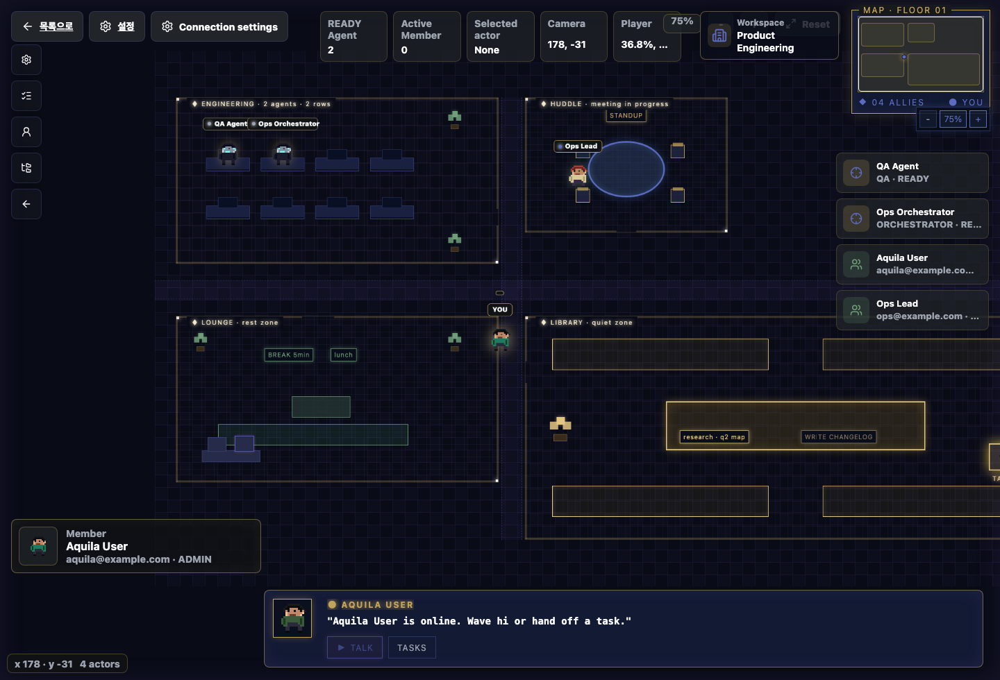
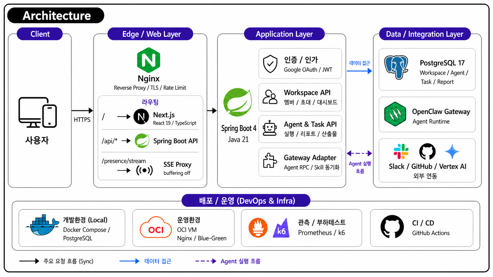

# 🤖 Aquila Office

> **협업형 AI 에이전트 워크스페이스 운영 플랫폼**<br>
> 업무 요청부터 AI Agent 실행, 결과 공유, 산출물 추적까지 하나의 팀 업무 흐름으로 연결합니다.

<p align="center">
  <a href="https://github.com/AquilaXk/aquila-office">
    
  </a>
  &nbsp;
  <a href="COMPLETION_CHECKLIST.md">
    
  </a>
</p>

<p align="center">
  
  
  
  
  
  
  
  
</p>



---

## 목차

- [프로젝트 개요](#프로젝트-개요)
- [주요 기능](#주요-기능)
- [화면으로 보는 주요 흐름](#화면으로-보는-주요-흐름)
- [시스템 아키텍처](#시스템-아키텍처)
- [주요 프로세스 / AI 설계](#주요-프로세스--ai-설계)
- [기술 스택](#기술-스택)
- [시작하기](#시작하기)
- [환경 변수](#환경-변수)
- [ERD](#erd)
- [API 명세](#api-명세)
- [테스트 커버리지](#테스트-커버리지)
- [모니터링](#모니터링)
- [CI/CD](#cicd)
- [트러블 슈팅](#트러블-슈팅)
- [성과 및 회고](#성과-및-회고)
- [관련 링크](#관련-링크)

---

## 프로젝트 개요

### 배경

AI Agent는 강력하지만, 실제 팀 업무 환경에서 안정적으로 운영하고 협업하기 위해서는 여러 현실적인 과제를 해결해야 합니다.

| 문제 | 설명 |
| --- | --- |
| 작업 흐름 분산 | 업무 요청, 에이전트 실행, 진행 보고, 최종 산출물이 서로 다른 도구와 터미널 로그에 파편화됨 |
| 실행 추적 어려움 | 백그라운드에서 진행 중인 작업의 상태(대기/진행/완료/실패)와 에러 원인을 팀원들이 한눈에 파악하기 어려움 |
| 결과 재사용 부족 | Agent의 작업 결과가 구조화된 Report, Artifact, Log 형태로 보존되지 않으면 후속 협업이나 코드 작업에 활용 불가 |
| 로컬 및 협업 환경 단절 | 웹 대시보드와 로컬 파일 시스템/Git 저장소가 단절되어 개발자의 로컬 작업 맥락을 에이전트와 매끄럽게 연결하기 어려움 |
| 연동 자격증명 관리 위험 | GitHub, Slack, Gateway runtime token 등 민감한 자격증명이 분산 관리되어 보안 사고 위험 노출 |

### 목표

Aquila Office는 단순한 단발성 AI 호출 UI가 아니라, 업무 요청부터 실행·기록·공유, 그리고 로컬 데스크톱 워크스페이스까지 끊김 없이 이어지는 협업형 AI 에이전트 운영 플랫폼을 목표로 합니다.

| 구분 | AS-IS | TO-BE |
| --- | --- | --- |
| **요청 방식** | 개별 메신저, CLI, 수동 터미널 명령 실행 | Workspace 웹/데스크톱 대시보드 및 Slack에서 자연어 기반 작업 요청 |
| **작업 공간** | 정적인 텍스트 테이블이나 채팅 목록 | Phaser 4 기반 2D 가상 오피스 캔버스와 실시간 Presence 아바타 이동 동기화 |
| **실행 단위** | 콘솔 출력 중심의 비구조화 로그 | Task, TaskExecution, AgentReport, Artifact tree 단위로 완벽히 구조화 |
| **데스크톱 연동** | 웹 브라우저 단절 및 로컬 파일 수동 복사 | Tauri 2 기반 데스크톱 쉘로 로컬 Git diff 감지, 파일 감시, OS 키체인 토큰 보관 지원 |
| **추적 방식** | 서버 터미널 및 분산 로그 수동 확인 | 대시보드에서 실시간 상태, 스트리밍 로그, 산출물 트리 통합 확인 |
| **연동 관리** | 환경변수나 로컬 파일에 평문 token 방치 | AES-GCM 256비트 암호화 및 Workspace 단위 Gateway, Slack, GitHub credential 관리 |

### 핵심 가치

- **Workspace 기반 격리 운영**: 팀 단위로 멤버, Agent, Task, 산출물, 외부 연동 자격증명을 안전하게 격리합니다.
- **2D 가상 오피스 인터랙션**: Phaser 4.1.0 기반의 직관적인 가상 오피스 공간에서 동료 멤버와 에이전트의 위치, 작업 상태를 실시간 시각화합니다.
- **Tauri 데스크톱 확장 (Desktop Superpowers)**: 데스크톱 쉘을 통해 OS 네이티브 보안 키체인 토큰 보관, 로컬 Git 저장소 diff/status 실시간 감지, 로컬 워크스페이스 파일 변경 감시를 제공합니다.
- **역할 기반 Agent 관리**: WorkspaceAgent와 Skill file 동기화를 통해 Agent 역할과 실행 프롬프트 맥락을 안정적으로 보존합니다.
- **투명한 실행 추적 및 산출물 보존**: TaskExecution, TaskExecutionLog, AgentReport, Artifact tree를 통해 요청부터 결과물까지 완전한 감사 추적성을 확보합니다.
- **안전한 엔터프라이즈 보안**: Google OAuth 2.0, JWT, AES-GCM 기반 외부 token 암호화, Slack 서명 검증, Fail-Closed 원칙을 철저히 준수합니다.

---

## 주요 기능

| 기능 | 설명 |
| --- | --- |
| **Workspace 관리** | 팀 단위 워크스페이스 생성, 멤버 목록, 관리자/멤버 역할 분리, 만료 기간을 갖는 초대 링크 발급 및 수락 |
| **2D 가상 오피스 캔버스** | Phaser 4 기반 그리드 맵, 캐릭터 아바타 노드, 우클릭 컨텍스트 메뉴, 뷰포트 확대/축소 및 아바타 이동 실시간 렌더링 |
| **Tauri 데스크톱 쉘** | OS 키체인 암호화 토큰 보관, 로컬 Git 브랜치/diff/상태 감지, 로컬 파일 감시(notify), 루프백 OAuth, 시스템 트레이 지원 |
| **Agent 생성 및 Skill 동기화** | WorkspaceAgent 생성 시 역할별 skill file을 저장하고 Gateway runtime과 동기화하여 에이전트 인격 및 도구 맥락 유지 |
| **Task 실행 및 라이프사이클** | 자연어 업무 요청 기반 Task 생성 및 즉시 실행, 기존 작업 재실행, 실행 상태 전이(RUNNING/SUCCEEDED/FAILED) 추적 |
| **운영 대시보드 요약** | 등록된 Agent 수, Task 실행 상태별 통계, 최근 생성된 Report, 실시간 Log 요약을 한 화면에 제공 |
| **Artifact & Report 뷰어** | Agent가 산출한 결과물을 파일 트리와 개별 Markdown 뷰어 형식으로 브라우징 및 다운로드 |
| **Workspace & Task Chat** | Workspace 전체 또는 개별 Task 맥락에서 등록된 Agent와 실시간 양방향 대화 및 업무 지시 |
| **실시간 Presence** | SSE(Server-Sent Events) 스트림 기반 멤버 접속 상태 감지 및 가상 오피스 캔버스 내 좌표 업데이트 |
| **Gateway 연동** | Workspace 단위 Gateway URL, RPC 경로, 암호화된 토큰 등록 및 연결 상태 진단 |
| **Slack 연동** | Slack App 설치, team/channel mapping, 서명 검증, 멘션 이벤트 기반 업무 자동 위임 및 처리 결과 회신 |
| **GitHub 연동** | Workspace별 GitHub credential 안전한 보관 및 리포지토리 작업 연계 |

---

## 화면으로 보는 주요 흐름

### 1. Workspace 목록

팀별 Workspace를 선택하고, 진행 중인 Task와 등록된 Agent 수를 먼저 확인합니다.


### 2. Workspace 운영 대시보드

Workspace 안에서는 Agent, 멤버, Task, Presence 상태가 하나의 운영 화면에 모입니다.


### 3. Agent 업무 실행과 Chat

Task 맥락에서 Agent에게 메시지를 보내고, 실행 세션과 응답을 같은 화면에서 추적합니다.


### 4. Report와 Artifact 확인

Agent 실행 결과는 Report와 Artifact 파일로 남아 다음 작업에서 다시 확인할 수 있습니다.


### 5. 외부 연동 설정

Slack, GitHub, OpenClaw Gateway 같은 외부 연동을 Workspace 단위로 관리합니다.


---

## 시스템 아키텍처



배포 환경은 Docker Compose, Nginx, OCI VM, Terraform, blue/green 배포 스크립트를 기준으로 구성되어 있습니다. 로컬 개발에서는 `compose.dev.yml`로 PostgreSQL, backend, frontend, nginx entrypoint를 함께 올릴 수 있습니다.

- **Frontend Application Layer**: Next.js 16 App Router 기반 반응형 웹 UI와 Phaser 4 2D 오피스 캔버스 엔진.
- **Desktop Application Layer**: Tauri 2 (Rust) 쉘로 감싸진 크로스 플랫폼 애플리케이션으로, OS 키체인, 로컬 Git diff, 파일 시스템 감시 IPC 제공.
- **Backend Core Layer**: Spring Boot 4.0.5 클린 아키텍처 기반 REST API, SSE 스트리밍, 비즈니스 도메인 서비스, Spring Security.
- **Data & Migration Layer**: PostgreSQL 17 관계형 데이터베이스 및 Flyway 버전 관리 마이그레이션(V1~V3).
- **AI & Integration Layer**: Gateway RPC 통신, Vertex AI 모델 연계, Slack Event/Webhook 연동, GitHub 연동.

---

## 주요 프로세스 / AI 설계

### 1. Workspace 중심 실행 모델

모든 실행은 Workspace를 기준으로 분리됩니다. Workspace는 멤버, Agent, Task, ChatSession, Artifact, SlackChannelMapping, GithubCredential, WorkspaceGatewayBinding을 소유합니다.

| 설계 포인트 | 내용 |
| --- | --- |
| 권한 분리 | `WorkspaceMember`가 멤버와 워크스페이스 role(ADMIN, MEMBER)을 연결하여 인가 경계 보호 |
| 실행 분리 | `Task`와 `TaskExecution`이 요청 메타데이터와 실행 라이프사이클을 엄격히 분리 |
| 결과 구조화 | `AgentReport`, `TaskExecutionLog`, Artifact tree로 산출물과 실행 로그를 영구 보존 |
| 통합 분리 | Slack, GitHub, Gateway 설정을 워크스페이스 단위로 격리하여 멀티테넌시 안전성 확보 |

### 2. Gateway 기반 Agent 실행

Backend가 모델 provider를 직접 호출하는 대신, Gateway binding을 통해 Agent runtime과 연결합니다. Gateway URL, `/rpc` path, encrypted token, connection status는 `WorkspaceGatewayBinding`으로 관리합니다.

```
Workspace → Gateway binding → Agent run request → TaskExecution → Report / Log / Artifact
```

### 3. Agent Skill file 동기화

Agent는 단순한 이름이 아니라 category, description, skill file을 함께 가집니다. `WorkspaceAgentSkillFile`은 Agent가 수행해야 할 역할과 실행 맥락을 파일 단위로 유지합니다.

### 4. Slack과 GitHub 통합 흐름

- Slack은 team/channel mapping, signing secret, duplicate event skip, processing failure metric을 통해 이벤트를 안전하게 처리합니다.
- GitHub credential은 encrypted token material로 저장하며, token은 log, issue, PR body, metric label에 노출하지 않습니다.

### 5. Smoke fixture 기반 검증

서비스 journey smoke는 `SPRING_PROFILES_ACTIVE=smoke`, `AQUILA_SMOKE_FIXTURE_ENABLED=true`에서 Google login과 Gateway execution을 결정적인 fixture adapter로 검증합니다.

---

## 기술 스택

| 영역 | 사용 기술 | 상세 내용 |
| --- | --- | --- |
| **Frontend** | Next.js 16, React 19, TypeScript, Phaser 4, Tailwind CSS, lucide-react, React Markdown, Playwright | Next.js 16.2.6 (App Router), React 19.2.4, TypeScript 5, Phaser 4.1.0 2D 캔버스, Playwright 1.60.0 브라우저 회귀 테스트 |
| **Desktop Shell** | Tauri 2, Rust | Tauri 2.11 (Rust 2021), Tokio 비동기 런타임, git2 (로컬 Git diff/status), keyring (OS 보안 키체인 토큰 암호화), notify (파일 감시) |
| **Backend** | Java 21, Spring Boot 4.0.5, Spring Security, Spring Data JPA, Springdoc OpenAPI, Flyway | Eclipse Temurin Java 21, Spring Boot 4.0.5, Springdoc OpenAPI 3.0.3, Checkstyle 10.23.1, SpotBugs 6.5.4, JaCoCo 0.8.14, ArchUnit 1.4.2 |
| **Database** | PostgreSQL 17, H2 test database | PostgreSQL 17 프로덕션 DB, H2 인메모리 테스트 DB, Flyway 데이터베이스 스키마 마이그레이션(V1~V3) |
| **Auth** | Google OAuth, JWT access/refresh token, hosted-domain allow list | Google OAuth2 ID 토큰 인증 및 데스크톱 루프백 흐름, JWT 토큰 발급/검증, Refresh 토큰 회전 정책 |
| **Realtime** | SSE presence stream, Phaser 2D Canvas | Server-Sent Events 기반 실시간 프레즌스 스트림 및 가상 오피스 좌표 실시간 동기화 |
| **AI / Agent** | OpenClaw Gateway, Vertex AI 설정, Agent skill file | OpenClaw Gateway RPC 프로토콜 통신, Vertex AI 모델 연계, 마크다운 기반 Agent Skill 파일 버전 관리 |
| **Security** | AES-GCM external token encryption, Slack HMAC signature verification | 256비트 AES-GCM 외부 토큰 암호화, 데스크톱 OS 키체인 토큰 보호, Slack v0 HMAC-SHA256 요청 서명 검증 |
| **Infra** | Docker Compose, Nginx, OCI VM, Terraform, blue/green deployment | Docker Compose (개발용 `compose.dev.yml`), Nginx 리버스 프록시, OCI Always Free A1 Flex ARM64 VM, Terraform 1.13.5 IaC, 무중단 Blue-Green 배포 |
| **CI/CD** | GitHub Actions, Desktop Release, Gradle Checkstyle, SpotBugs, JUnit 5, JaCoCo, frontend lint/build/browser test | GitHub Actions 멀티 게이트 CI, 데스크톱 크로스 플랫폼(macOS/Windows) 릴리스 파이프라인, Staging 자동 CD |
| **Monitoring** | Actuator, Prometheus metrics, k6 smoke | Spring Boot Actuator 프로브, Prometheus 커스텀 메트릭 수집(`/actuator/prometheus`), k6 서비스 저니 스모크 부하 테스트 |

---

## 시작하기

### 사전 요구사항

- Java 21 (Eclipse Temurin 21 권장)
- Node.js 20 이상 (Node.js 22 권장)
- Docker Desktop 또는 호환 Docker engine
- PostgreSQL 17 (Compose 없이 직접 로컬 실행할 때)
- Rust & Cargo (Tauri 데스크톱 빌드 및 개발 시 필요)
- k6 (로컬 smoke test)
- 선택 통합용 Google OAuth, Slack, GitHub, Gateway credential

### 1. 저장소 클론

```bash
git clone https://github.com/AquilaXk/aquila-office.git
cd aquila-office
```

### 2. 환경 변수 설정

```bash
cp .env.example .env
```

`vertex-key.json`은 git에 올리지 않습니다. Compose에서는 `VERTEX_AI_CREDENTIALS_HOST_PATH`로 local service account key를 mount합니다.

### 3. Docker Compose 빠른 시작

```bash
docker compose --env-file .env.example -f compose.dev.yml up --build
```

기본 endpoint:

- 백엔드 API: `http://localhost:8080`
- 프론트엔드 앱: `http://localhost:3000`
- Health: `GET /api/health`
- Swagger UI: `http://localhost:8080/swagger-ui.html`
- Prometheus metrics: `GET /actuator/prometheus`

### 4. 백엔드 직접 실행

```bash
./back/gradlew -p back check
./back/gradlew -p back bootRun
```

### 5. 프론트엔드 직접 실행

```bash
npm --prefix front install
npm --prefix front run test:node
npm --prefix front run lint
npm --prefix front run build
npx --prefix front playwright install chromium
npm --prefix front run test:browser
npm --prefix front run dev
```

데스크톱 앱 빌드 및 Rust 검증 (선택):

```bash
BUILD_TARGET=desktop npm --prefix front run build
cargo check --manifest-path front/src-tauri/Cargo.toml
cargo test --manifest-path front/src-tauri/Cargo.toml
```

### 6. 첫 사용자와 Gateway 연결

Google OAuth가 기본 로그인 경로입니다. `AQUILA_GOOGLE_OAUTH_CLIENT_IDS`와 `NEXT_PUBLIC_GOOGLE_CLIENT_ID`를 설정한 뒤 frontend에서 로그인합니다. Gateway 실행 검증은 workspace Gateway 설정에서 URL과 token을 등록한 뒤 `/api/v1/workspaces/{workspaceId}/gateway` 상태를 확인합니다.

---

## 환경 변수

루트 `.env` 또는 배포 환경 변수에 아래 값을 설정합니다.

### 인증

| 변수 | 기본값 | 설명 |
| --- | --- | --- |
| `AQUILA_AUTH_TOKEN_ISSUER` | `aquila-office` | JWT issuer |
| `AQUILA_AUTH_TOKEN_SECRET` | - | JWT signing secret (최소 32바이트. 로컬 밖에서는 반드시 안전한 시크릿으로 교체) |
| `AQUILA_AUTH_ACCESS_TOKEN_TTL` | `15m` | access token 유효 기간 |
| `AQUILA_AUTH_REFRESH_TOKEN_TTL` | `14d` | refresh token 유효 기간 |
| `AQUILA_AUTH_REFRESH_COOKIE_SECURE` | `false` | refresh token cookie Secure 플래그 (운영 시 true 권장) |
| `AQUILA_GOOGLE_OAUTH_CLIENT_IDS` | - | 허용할 Google OAuth client ID 목록 (쉼표 구분) |
| `AQUILA_GOOGLE_ALLOWED_HOSTED_DOMAINS` | - | 선택 Google hosted-domain allow list |
| `AQUILA_GOOGLE_REQUIRE_EMAIL_VERIFIED` | `true` | Google email verified claim 요구 여부 |
| `AQUILA_GOOGLE_APPLICATION_NAME` | `aquila-office` | Google API 클라이언트 애플리케이션 식별자 |
| `NEXT_PUBLIC_GOOGLE_CLIENT_ID` | - | frontend 웹/데스크톱 UI용 Google OAuth client ID |

### 데이터베이스

| 변수 | 기본값 | 설명 |
| --- | --- | --- |
| `POSTGRES_DB` | `aquila_office` | 로컬 PostgreSQL database 이름 |
| `POSTGRES_USER` | `aquila` | 로컬 PostgreSQL user |
| `POSTGRES_PASSWORD` | - | 로컬 PostgreSQL password |
| `POSTGRES_PORT` | `5432` | PostgreSQL 호스트 포트 |
| `SPRING_DATASOURCE_URL` | - | backend datasource JDBC URL |
| `SPRING_DATASOURCE_USERNAME` | - | backend datasource user |
| `SPRING_DATASOURCE_PASSWORD` | - | backend datasource password |
| `SPRING_FLYWAY_ENABLED` | `true` | Flyway 스키마 마이그레이션 활성화 여부 |
| `SPRING_JPA_HIBERNATE_DDL_AUTO` | `validate` | JPA ddl-auto 정책 (로컬 dev: update, prod: validate) |

### DB 접근 정책

현재 DB 연결은 Spring backend가 소유합니다. Frontend는 backend API만 호출하고 DB credential을 보관하지 않습니다. `NEXT_PUBLIC_*` 환경 변수에는 browser에 공개 가능한 API URL, OAuth client ID, site URL만 둡니다.

공개 DB API를 추가할 때는 노출 대상 테이블의 RLS 정책과 anon 권한을 먼저 정의합니다. 그 전까지 PostgreSQL credential과 service-role 성격의 key는 backend runtime, Compose secret, 배포 환경 변수에만 둡니다.

### 외부 token 암호화

| 변수 | 기본값 | 설명 |
| --- | --- | --- |
| `AQUILA_EXTERNAL_TOKEN_KEY` | - | 외부 token용 AES-GCM 256비트 대칭키 (최소 32바이트) |
| `AQUILA_EXTERNAL_TOKEN_KEY_ID` | `prod` | 외부 token 암호화 key identifier |

### Gateway 연동

| 변수 | 기본값 | 설명 |
| --- | --- | --- |
| `AQUILA_GATEWAY_RPC_REQUEST_TIMEOUT` | `30s` | Gateway RPC 요청 타임아웃 |
| `AQUILA_GATEWAY_RPC_PATH` | `/rpc` | Gateway RPC 엔드포인트 기본 경로 |

### Vertex AI

| 변수 | 기본값 | 설명 |
| --- | --- | --- |
| `GOOGLE_CLOUD_PROJECT_ID` | - | Vertex AI Google Cloud project ID |
| `VERTEX_AI_LOCATION` | `us-central1` | Vertex AI 리전 |
| `VERTEX_AI_MODEL` | `gemini-2.5-flash` | Vertex AI 기본 모델 |
| `GOOGLE_APPLICATION_CREDENTIALS` | - | 런타임 서비스 계정 키 파일 경로 |
| `VERTEX_AI_CREDENTIALS_HOST_PATH` | `./vertex-key.json` | Compose에 마운트할 로컬 서비스 계정 키 경로 |

### Slack 연동

| 변수 | 기본값 | 설명 |
| --- | --- | --- |
| `AQUILA_SLACK_CLIENT_ID` | - | Slack OAuth client ID |
| `AQUILA_SLACK_CLIENT_SECRET` | - | Slack OAuth client secret |
| `AQUILA_SLACK_SIGNING_SECRET` | - | Slack event HMAC 서명 검증 secret |
| `AQUILA_SLACK_REDIRECT_URI` | `http://localhost:8080/api/v1/slack/oauth/callback` | Slack OAuth 리다이렉트 URI |
| `AQUILA_SLACK_SCOPES` | `app_mentions:read,channels:read,chat:write,incoming-webhook` | 요청할 Slack 권한 스코프 |

### 메일 및 초대 연동

| 변수 | 기본값 | 설명 |
| --- | --- | --- |
| `SPRING_MAIL_HOST` | `localhost` | SMTP 호스트 |
| `SPRING_MAIL_PORT` | `1025` | SMTP 포트 |
| `SPRING_MAIL_USERNAME` | - | SMTP 사용자명 |
| `SPRING_MAIL_PASSWORD` | - | SMTP 비밀번호 |
| `AQUILA_INVITE_EMAIL_ENABLED` | `false` | 초대 메일 발송 활성화 여부 |
| `AQUILA_INVITE_EMAIL_FROM` | `noreply@aquila-office.local` | 초대 메일 발신자 주소 |
| `AQUILA_INVITE_ACCEPT_URL_BASE` | `http://localhost:3000/invites/accept` | 초대 링크 기본 URL |

### 공통

| 변수 | 기본값 | 설명 |
| --- | --- | --- |
| `COMPOSE_PROJECT_NAME` | `aquila-office` | Docker Compose 프로젝트 이름 |
| `BACKEND_PORT` | `8080` | backend 컨테이너 호스트 포트 |
| `FRONTEND_PORT` | `3000` | frontend 컨테이너 호스트 포트 |
| `NEXT_PUBLIC_API_BASE_URL` | `http://localhost:8080` | frontend가 호출할 백엔드 API 기본 URL |
| `NEXT_PUBLIC_SITE_URL` | `http://localhost:3000` | frontend 웹사이트 공개 URL |
| `CUSTOM_CORS_ALLOWED_ORIGIN_PATTERNS` | `http://localhost:3000,http://localhost` | backend가 허용하는 CORS 브라우저 origin 패턴 |
| `NGINX_HTTP_PORT` | `80` | Nginx 리버스 프록시 HTTP 포트 |

---

## ERD

Aquila Office의 데이터 모델은 Workspace를 단일 소유자 경계로 하며, 멤버 권한, 에이전트 인격 및 스킬, 작업 실행 수명 주기, 외부 연동 자격증명을 완전하게 분리합니다.

```
Member (users) ──< MemberProfile
      │
      ├──< RefreshToken
      │
      └──< WorkspaceMember >── Workspace ──< WorkspaceAgent ──< WorkspaceAgentSkillFile
                                    ├──< WorkspaceInvite
                                    ├──< Task ──< TaskExecution ──< TaskExecutionLog
                                    │                 └──< AgentReport / Artifact
                                    ├──< ChatSession ──< ChatMessage
                                    ├──< WorkspaceGatewayBinding
                                    ├──< SlackChannelMapping ──< SlackEventReceipt
                                    ├──< GithubCredential
                                    └──< OrchestrationSession ──< OrchestrationStep
```

| Entity | 테이블명 | 역할 및 설명 |
| --- | --- | --- |
| `Member` | `users` | Google 계정 기반 회원 엔티티 (`email`, `google_sub`, 시스템 역할 `ADMIN`/`USER`) |
| `MemberProfile` | `member_profiles` | 가상 오피스 아바타 외형(스킨/헤어/셔츠 색상, 아바타 종류) 및 표시 이름 |
| `RefreshToken` | `refresh_tokens` | 안전한 JWT 토큰 갱신을 위한 Hashed Refresh Token 저장소 |
| `Workspace` | `workspaces` | 팀 단위 업무 공간, 에이전트, 작업, 외부 연동의 최상위 소유자 |
| `WorkspaceMember` | `workspace_members` | 워크스페이스 참여 멤버 및 권한 역할 (`ADMIN`, `MEMBER`) 매핑 |
| `WorkspaceInvite` | `workspace_invites` | 워크스페이스 초대 링크 수명 주기 (`PENDING`, `ACCEPTED`, `EXPIRED`, `REVOKED`) |
| `WorkspaceAgent` | `workspace_agents` | 워크스페이스에 배속된 AI 에이전트 식별자, 역할, 카테고리 |
| `WorkspaceAgentSkillFile` | `workspace_agent_skill_files` | 에이전트 역할별 실행 맥락과 지침을 담은 마크다운 스킬 정의 파일 |
| `Task` | `tasks` | 사용자 자연어 요청으로부터 생성된 업무 단위 및 상태 |
| `TaskExecution` | `task_executions` | Task 실행 수명 주기(시작/종료 시각, 상태 `RUNNING`/`SUCCEEDED`/`FAILED`) |
| `TaskExecutionLog` | `task_execution_logs` | Task 실행 중 실시간으로 발생한 타임스탬프 기반 콘솔 로그 라인 |
| `AgentReport` | `agent_reports` | 작업 완료 후 에이전트가 생성한 요약 리포트 마크다운 본문 |
| `ChatSession` | `chat_sessions` | 워크스페이스 또는 개별 Task 맥락의 대화 세션 |
| `ChatMessage` | `chat_messages` | 멤버와 에이전트 간 주고받은 발신자별 메시지 내역 |
| `WorkspaceGatewayBinding` | `workspace_gateway_bindings` | Workspace와 Agent Runtime Gateway 간의 RPC 바인딩 및 연결 진단 상태 |
| `SlackChannelMapping` | `slack_channel_mappings` | Slack 워크스페이스 채널과 Aquila Office 워크스페이스 간 양방향 매핑 |
| `SlackEventReceipt` | `slack_event_receipts` | Slack 웹훅 이벤트 중복 처리 방지를 위한 이벤트 수신 영수증 |
| `GithubCredential` | `github_credentials` | 저장소 작업을 위한 AES-GCM 암호화된 GitHub Personal Access Token |
| `OrchestrationSession` | `orchestration_sessions` | 복합 멀티스텝 에이전트 오케스트레이션 세션 수명 주기 |
| `OrchestrationStep` | `orchestration_steps` | 오케스트레이션 세션 내 개별 실행 단계 및 상태 전이 |

---

## API 명세

Swagger UI는 로컬 backend 실행 후 `http://localhost:8080/swagger-ui.html`에서 대화형으로 확인할 수 있습니다.

### 핵심 API 요약

| 도메인 | Method | Endpoint | 설명 | 기술 포인트 |
| --- | --- | --- | --- | --- |
| 상태 | GET | `/api/health` | 서비스 public health envelope | Actuator 외 비인가 public 헬스 프로브 |
| 인증 | POST | `/api/v1/auth/google/login` | Google OAuth 로그인 | ID 토큰 검증, JWT access/refresh 토큰 발급 |
| 인증 | POST | `/api/v1/auth/token/refresh` | Access token 갱신 | Refresh token 로테이션 및 재발급 |
| 인증 | POST | `/api/v1/auth/logout` | 사용자 로그아웃 | Refresh token 무효화 및 쿠키 클리어 |
| 프로필 | GET | `/api/v1/members/me/profile` | 내 아바타 프로필 조회 | 2D 가상 오피스 아바타 외형 속성 |
| 프로필 | PATCH | `/api/v1/members/me/profile` | 내 아바타 프로필 변경 | 닉네임 및 아바타 색상 실시간 갱신 |
| 워크스페이스 | GET | `/api/v1/workspaces` | 참여 중인 workspace 목록 | 권한 기반 멤버십 필터링 |
| 워크스페이스 | POST | `/api/v1/workspaces` | 새 workspace 생성 | 생성자에게 워크스페이스 ADMIN 자동 부여 |
| 워크스페이스 | GET | `/api/v1/workspaces/{workspaceId}` | workspace 상세 정보 조회 | 멤버십 확인 및 세부 정보 반환 |
| 워크스페이스 | POST | `/api/v1/workspaces/{workspaceId}/invites` | 워크스페이스 초대 생성 | 만료 기간 및 고유 토큰 발급 |
| 대시보드 | GET | `/api/v1/workspaces/{workspaceId}/dashboard/summary` | Agent, Task, log, report 요약 | 운영 지표 단일 쿼리 애그리게이션 |
| 에이전트 | GET | `/api/v1/workspaces/{workspaceId}/agents` | workspace agent 목록 | 카테고리 및 스킬 파일 요약 포함 |
| 에이전트 | POST | `/api/v1/workspaces/{workspaceId}/agents` | agent 생성과 skill 동기화 | Gateway runtime 동기화 및 스킬 파일 생성 |
| 작업 | POST | `/api/v1/workspaces/{workspaceId}/tasks/run` | task 생성과 실행 | 비동기 Agent 실행 트리거 및 TaskExecution 생성 |
| 작업 | GET | `/api/v1/workspaces/{workspaceId}/tasks/{taskId}/logs` | task 실행 실시간 로그 조회 | 타임스탬프 순 로그 라인 스트림 |
| 리포트 | GET | `/api/v1/workspaces/{workspaceId}/tasks/{taskId}/reports` | task execution report 목록 | 마크다운 포맷 실행 산출물 리포트 |
| 산출물 | GET | `/api/v1/workspaces/{workspaceId}/artifacts/tree` | agent 산출물 파일 트리 조회 | 디렉터리/파일 계층 구조 반환 |
| 채팅 | POST | `/api/v1/workspaces/{workspaceId}/chat/messages` | agent에게 대화 메시지 전송 | 워크스페이스/작업 맥락 기반 메시징 |
| Gateway | GET | `/api/v1/workspaces/{workspaceId}/gateway` | Gateway binding 상태 | 암호화된 토큰 복호화 및 연결 헬스 확인 |
| Gateway | POST | `/api/v1/workspaces/{workspaceId}/gateway/connection-test` | Gateway 연결 사전 진단 | RPC handshake 사전 검증 |
| Presence | GET | `/api/v1/workspaces/{workspaceId}/presence/stream` | workspace presence stream | Server-Sent Events 기반 실시간 스트림 |
| Presence | PATCH | `/api/v1/workspaces/{workspaceId}/presence/me/position` | 내 가상 오피스 위치 갱신 | 2D 캔버스 X/Y 좌표 동기화 브로드캐스트 |
| Slack | POST | `/api/v1/workspaces/{workspaceId}/slack/events` | Slack 웹훅 이벤트 수신 | HMAC 서명 검증 및 멘션 이벤트 처리 |
| GitHub | POST | `/api/v1/workspaces/{workspaceId}/github/credentials` | GitHub 자격증명 등록 | AES-GCM 암호화 보관 |

---

## 테스트 커버리지

GitHub Actions CI와 로컬 게이트에서 백엔드, 프론트엔드, 데스크톱, 스모크, 워크플로우 계약을 완벽히 검증합니다.

| 항목 | 검증 도구 | 실행 명령어 / 검증 기준 |
| --- | --- | --- |
| **Backend Quality Gate** | Gradle, Checkstyle, SpotBugs | `./back/gradlew -p back check` |
| **Backend Coverage** | JaCoCo | JaCoCo line coverage minimum 80% (Bundle 80% 미달 시 빌드 실패) |
| **Backend Architecture** | ArchUnit 1.4.2 | 레이어 간 참조 규칙 및 클린 아키텍처 불변식 준수 |
| **Frontend Unit** | Node.js Test Runner | `npm --prefix front run test:node` (단위/통합 비즈니스 로직 테스트) |
| **Frontend Quality** | ESLint 9, Next.js Compiler | `npm --prefix front run lint`, `npm --prefix front run build` |
| **Browser Regression** | Playwright Chromium | `npm --prefix front run test:browser` (E2E 브라우저 회귀 테스트) |
| **Desktop Build Gate** | Next.js Static Export | `BUILD_TARGET=desktop npm --prefix front run build` |
| **Desktop Rust Gate** | Cargo | `cargo check --manifest-path front/src-tauri/Cargo.toml`, `cargo test` |
| **README Contract** | Custom Node.js Validator | `node tools/readme/validate-readme.mjs` (헤딩, 스니펫, 라이선스 무결성 검증) |
| **Smoke Definition Gate** | k6 Smoke Validator | `node tools/perf/validate-k6-smoke.mjs` |
| **Workflow Contract** | Shell / Node.js Test | `bash tools/test/check-staging-cd-contract.sh`, `node --test tools/ci/resolve-ci-gates.test.mjs` |
| **Terraform Infra Gate** | HashiCorp Terraform | `terraform fmt -check`, `terraform validate` |

---

## 모니터링

| 도구 | 역할 |
| --- | --- |
| **Spring Boot Actuator** | `/actuator/health`, readiness, liveness 프로브 엔드포인트 제공 |
| **Prometheus** | `/actuator/prometheus` 엔드포인트를 통한 커스텀 비즈니스 및 인프라 메트릭 수집 |
| **k6** | 서비스 사용자 여정(Journey) smoke 테스트 및 성능 부하 검증 |
| **GitHub Actions** | CI 품질 게이트, 워크플로우 계약 검증, 스테이징 무중단 배포 추적 |

### 주요 metric

| Metric | Label | 용도 |
| --- | --- | --- |
| `aquila_task_execution_started_total` | none | 작업 실행 시작 count |
| `aquila_task_execution_completed_total` | `status=succeeded\|failed` | 작업 실행 결과 count |
| `aquila_task_execution_duration_seconds` | `status=succeeded\|failed` | 작업 실행 latency |
| `aquila_gateway_rpc_requests_total` | `method` | Gateway RPC request count |
| `aquila_gateway_rpc_completed_total` | `method`, `outcome=success\|failure\|timeout` | Gateway RPC result count |
| `aquila_slack_events_received_total` | `route=global\|workspace` | Slack event receive count |
| `aquila_slack_events_signature_failures_total` | `route=global\|workspace` | Slack signature verification failure |

Metric label은 고정된 low-cardinality 값만 사용합니다. Workspace ID, user ID, URL, token, prompt, failure text는 label로 쓰지 않습니다.

### 로컬 smoke 점검

```bash
tools/test/run-k6-smoke.sh
```

Smoke 범위에는 `GET /api/health`, `GET /actuator/prometheus`, Google login fixture, workspace 생성, Gateway binding, Agent 생성, Task 실행, Report 조회가 포함됩니다.

---

## CI/CD

```
Pull Request / main push
        │
        ▼
GitHub Actions CI
  ├── Resolve Changed Files (스마트 게이트 분기 판별)
  ├── Backend Quality Gate (Checkstyle, SpotBugs, JaCoCo 80%, ArchUnit, Test)
  ├── Frontend Quality Gate (ESLint, Node tests, Next.js build, Playwright browser test)
  ├── Smoke Definition Gate (k6 smoke 계약 검증)
  ├── Workflow Contract Gate (CI gate resolver, Staging CD 계약 검증)
  ├── Terraform Infra Gate (OCI Terraform fmt/validate)
  └── README Documentation Gate (validate-readme.mjs)
        │
        ├────────────────────────────────────────┐
        ▼ (main branch push / CD trigger)        ▼ (tag push: v*)
Staging CD (ARM64 OCI VM)                Desktop Release
  ├── backend/frontend ARM64 image build   ├── macOS Universal build (x86_64 + Apple Silicon)
  ├── OCI self-hosted runner hook          ├── Windows x64 build
  ├── blue/green zero-downtime deploy      └── GitHub Release 자동 생성 및 바이너리 업로드
  └── health 확인 후 Nginx reload
```

배포 스크립트:

- `scripts/deploy/backend-blue-green.sh`
- `scripts/deploy/frontend-blue-green.sh`
- `scripts/deploy/oci-backend-hook.sh`
- `scripts/deploy/oci-frontend-hook.sh`
- `scripts/deploy/validate-backend-cd.sh`

릴리즈 전 점검:

```bash
node tools/readme/validate-readme.mjs
node tools/perf/validate-k6-smoke.mjs
gh issue list --repo AquilaXk/aquila-office --state open --limit 50
gh run list --repo AquilaXk/aquila-office --branch main --limit 10
```

---

## 트러블 슈팅

### 1. Backend가 시작하지 않음

| | 내용 |
| --- | --- |
| **확인** | Java 21, port `8080`, database 상태 |
| **명령** | `./back/gradlew -p back bootRun` |
| **해결** | 포트 `8080` 충돌 여부(`lsof -i :8080`), PostgreSQL 컨테이너 헬스(`docker compose ps`), Flyway 마이그레이션 로그를 순서대로 확인합니다. |

### 2. Frontend가 API에 연결하지 못함

| | 내용 |
| --- | --- |
| **확인** | `NEXT_PUBLIC_API_BASE_URL`, backend CORS pattern, browser network log |
| **해결** | `.env`의 API base URL과 `CUSTOM_CORS_ALLOWED_ORIGIN_PATTERNS`를 맞춤 |

### 3. Google login 실패

| | 내용 |
| --- | --- |
| **확인** | `AQUILA_GOOGLE_OAUTH_CLIENT_IDS`, hosted-domain allow list, email verified 설정 |
| **해결** | ID token audience가 backend에 설정된 client ID와 일치하도록 조정 |

### 4. Gateway agent run 실패

| | 내용 |
| --- | --- |
| **확인** | Gateway URL, `/rpc` path, encrypted token, `/api/v1/workspaces/{workspaceId}/gateway` |
| **해결** | workspace Gateway binding과 runtime connection status를 다시 확인 |

### 5. Slack event 실패

| | 내용 |
| --- | --- |
| **확인** | signing secret, OAuth callback URL, channel mapping, event deduplication state |
| **해결** | Slack App 설정과 workspace mapping을 재설정 |

### 6. k6 smoke health 실패

| | 내용 |
| --- | --- |
| **확인** | `/actuator/health/liveness`, `/actuator/health/readiness`, `/actuator/prometheus` |
| **명령** | 각 endpoint를 `curl -i`로 개별 확인 |

---

## 성과 및 회고

### 성과

- Workspace 기반으로 Agent, Task, Report, Artifact, Chat, Presence, Integration을 한 화면에서 다루는 운영 흐름을 구성했습니다.
- Next.js 웹 대시보드와 Phaser 4 2D 가상 오피스 캔버스, Tauri 2 데스크톱 쉘을 유기적으로 연계하여 엔터프라이즈 에이전트 협업 경험을 한 단계 끌어올렸습니다.
- Google OAuth, JWT, encrypted external token, Slack signature verification으로 인증과 외부 credential 보호를 분리했습니다.
- JaCoCo 80% line coverage gate, Checkstyle, SpotBugs, frontend lint/build/browser regression, smoke definition gate를 CI에 연결했습니다.
- 완료 기준은 [COMPLETION_CHECKLIST.md](COMPLETION_CHECKLIST.md)에 기록합니다.

### 개선 방향

| 현재 | 발전 방향 |
| --- | --- |
| Slack/GitHub/Gateway 중심 통합 | Discord 등 추가 협업 채널 연동 |
| Workspace 단위 수동 credential 등록 | GitHub App, OAuth 기반 credential onboarding 강화 |
| Gateway run 실패 시 수동 확인 | 실패 유형별 자동 재시도와 사용자 안내 강화 |
| 운영 metric 기본 제공 | dashboard와 alert rule을 더 촘촘하게 연결 |

---

## 관련 링크

Aquila Office는 [MIT License](LICENSE)를 적용합니다.

| 구분 | URL |
| --- | --- |
| GitHub | [Aquila Office](https://github.com/AquilaXk/aquila-office) |
| 릴리즈 증적 | [COMPLETION_CHECKLIST.md](COMPLETION_CHECKLIST.md) |
| 라이선스 | [MIT License](LICENSE) |
| 로컬 Swagger UI | `http://localhost:8080/swagger-ui.html` |
| 로컬 API health | `http://localhost:8080/api/health` |
| Prometheus metrics | `http://localhost:8080/actuator/prometheus` |

---

> Aquila Office는 팀 업무 흐름 안에서 AI Agent 실행을 운영·추적하기 위한 프로젝트입니다.
