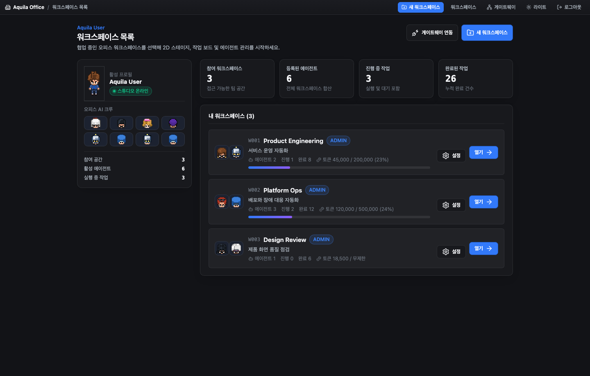
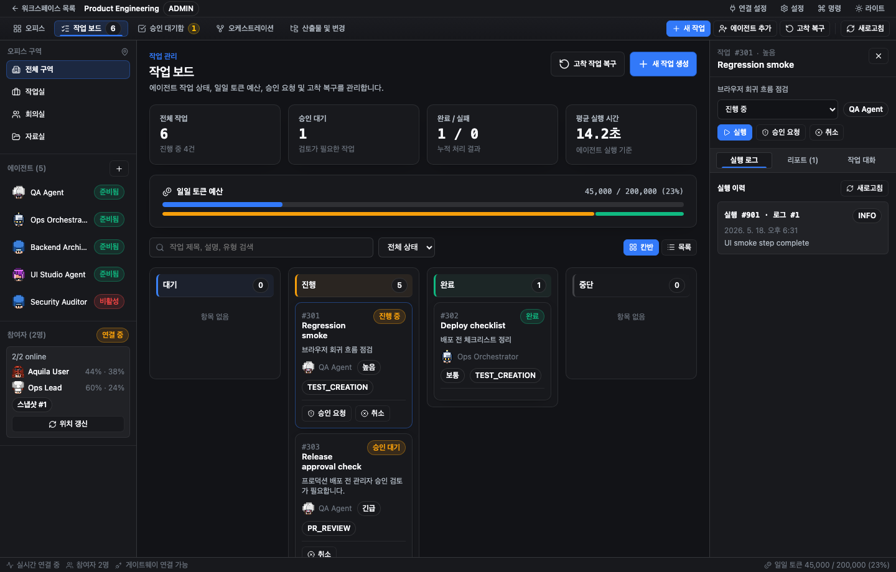
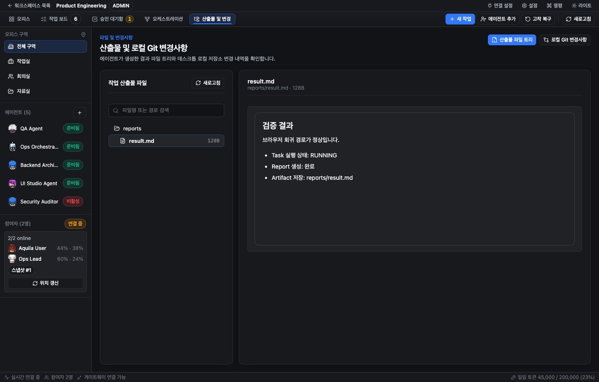
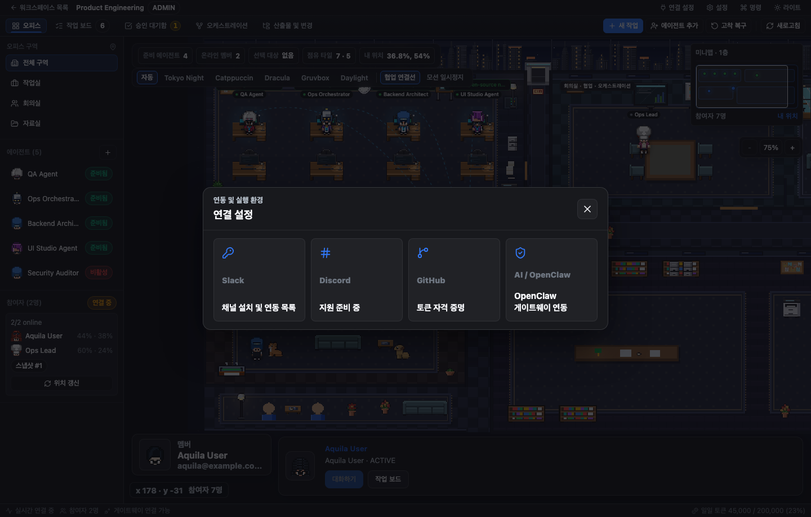

# Aquila Office

**팀과 AI 에이전트가 한 공간에서 협업하는 2D 가상 오피스·워크스페이스 플랫폼**

Aquila Office는 팀별 워크스페이스 안에서 AI 에이전트 등록·조율, 태스크 실행, 실시간 대화, 산출물 검증을 하나의 흐름으로 연결하는 데스크톱·웹 애플리케이션입니다. macOS, Windows, Linux 데스크톱 앱과 Docker Compose 기반 자체 호스팅 서버를 모두 지원합니다.

화면은 Next.js 웹 클라이언트와 [Tauri](https://tauri.app) v2 데스크톱 셸(Rust)로 구성했고, 백엔드는 Spring Boot 4(Java 21)와 PostgreSQL 17 위에서 동작합니다. 데스크톱 앱은 OS 보안 키체인 토큰 보관, 로컬 Git 상태·diff 감지, 파일 시스템 감시 같은 네이티브 통합을 맡습니다.


## 할 수 있는 일

* **워크스페이스 격리 운영**: 팀 단위로 멤버 권한(ADMIN/MEMBER), 에이전트, 일일 토큰 예산, 외부 연동 자격증명(AES-256-GCM 암호화)을 분리해 관리합니다.
* **2D 가상 오피스 스테이지**: 픽셀 오피스 맵(5종 테마, 아트리움·스카이라인·펫)과 다층 캐릭터·장비 커스터마이징을 제공하며 실시간 프레즌스와 협업 연결선을 시각화합니다.
* **태스크 실행 & 실시간 에이전트 채팅**: 자연어 지시로 태스크를 생성·실행하고 스트리밍 로그, 실행 리포트, 마크다운 산출물 트리를 한 화면에서 추적합니다.
* **멀티 에이전트 오케스트레이션 & 승인함**: DAG 의존성(`dependsOn`) 그래프 기반으로 여러 에이전트를 순차·병렬 실행하고, 사용자 승인이 필요한 단계는 승인함에서 검토합니다.
* **에이전트 인격·스킬 동기화**: 마크다운 기반 스킬 파일을 편집하고 Gateway RPC를 통해 에이전트 런타임과 양방향으로 동기화합니다.
* **데스크톱 OS 통합**: macOS Keychain·Windows Credential Manager·Linux Secret Service 키체인 저장, 로컬 Git 브랜치/diff 확인, 워크스페이스 파일 변경 감시를 지원합니다.
* **Slack·GitHub·Gateway 연동**: 워크스페이스별 Gateway RPC 바인딩 진단, Slack 이벤트 HMAC 서명 검증·멘션 처리, GitHub PAT 암호화 보관을 지원합니다.

## 주요 화면

<details>
<summary>워크스페이스 목록 · 대시보드 · 에이전트 채팅 · 산출물 리포트 · 외부 연동 화면 보기</summary>

| 워크스페이스 목록 | 운영 대시보드 & 2D 오피스 |
| --- | --- |
|  |  |

| 태스크 실행 & 에이전트 채팅 | 리포트 & 산출물 뷰어 |
| --- | --- |
|  |  |

| 외부 연동 설정 (Gateway · Slack · GitHub) |
| --- |
|  |

</details>

## 다운로드

최신 릴리스는 아래 링크에서 받을 수 있습니다.

* [macOS 유니버설 (.dmg)](https://github.com/AquilaXk/aquila-office/releases/latest/download/AquilaOffice-macos-universal.dmg)
* [Windows x64 (설치 프로그램)](https://github.com/AquilaXk/aquila-office/releases/latest/download/AquilaOffice-windows-x64-setup.exe)
* [Linux x64 (.deb, Ubuntu/Debian 계열 권장)](https://github.com/AquilaXk/aquila-office/releases/latest/download/AquilaOffice-linux-x64.deb)
* [Linux x64 (.rpm, Fedora/openSUSE 계열)](https://github.com/AquilaXk/aquila-office/releases/latest/download/AquilaOffice-linux-x64.rpm)
* [Linux x64 (AppImage, portable)](https://github.com/AquilaXk/aquila-office/releases/latest/download/AquilaOffice-linux-x64.AppImage)
* [Linux arm64 (.deb, Ubuntu/Debian 계열)](https://github.com/AquilaXk/aquila-office/releases/latest/download/AquilaOffice-linux-arm64.deb)

받은 파일은 [SHA256SUMS.txt](https://github.com/AquilaXk/aquila-office/releases/latest/download/SHA256SUMS.txt)의 체크섬과 비교할 수 있습니다.

전체 릴리스는 [GitHub Releases](https://github.com/AquilaXk/aquila-office/releases)에서 확인할 수 있습니다.

## 설치 유의사항

### macOS

macOS 빌드는 아직 Apple Developer ID로 서명·공증하지 않아 처음 실행할 때 Gatekeeper가 막습니다. 한 번만 허용하면 됩니다.

1. Finder에서 `/Applications`의 `Aquila Office.app`을 우클릭(또는 Control-클릭)해 `열기`를 고르고, 대화상자에서 다시 `열기`를 누릅니다.
2. macOS 15에서는 한 번 열기를 시도한 뒤 `시스템 설정 > 개인정보 보호 및 보안`에서 `그래도 열기`를 누릅니다.
3. 앱이 손상되었다고 표시되면 격리 속성을 한 번 제거합니다.

```sh
xattr -dr com.apple.quarantine "/Applications/Aquila Office.app"
```

### Windows

Windows 빌드는 아직 코드 서명되지 않아 SmartScreen에서 "Windows의 PC 보호" 경고가 뜰 수 있습니다. `추가 정보`를 누른 뒤 `실행`을 선택합니다. 브라우저가 다운로드를 막으면 다운로드 목록에서 먼저 `유지`를 선택합니다. 무결성이 의심스러우면 PowerShell에서 `Get-FileHash .\AquilaOffice-windows-x64-setup.exe` 결과를 `SHA256SUMS.txt`와 비교합니다.

### Linux

Linux에서는 배포판에 맞는 네이티브 패키지(`.deb`, `.rpm`)를 우선 사용해 주세요. arm64 Linux는 Ubuntu/Debian 계열 `.deb`만 제공합니다.

```sh
sudo apt install ./AquilaOffice-linux-x64.deb   # Ubuntu, Debian
sudo dnf install ./AquilaOffice-linux-x64.rpm   # Fedora
```

AppImage는 설치가 필요 없지만 실행 권한(`chmod +x AquilaOffice-linux-x64.AppImage`)과 `libfuse2` 패키지가 필요합니다. 패키지는 glibc 2.35 이상과 WebKitGTK 4.1이 필요합니다(Ubuntu 22.04 이상, Debian 12 이상).

## 개발하기

```sh
# 1. 환경 변수 준비 (vertex-key.json 등 비밀 파일은 커밋하지 않음)
cp .env.example .env

# 2. Docker Compose로 백엔드·프론트엔드·PostgreSQL 한 번에 실행
docker compose --env-file .env.example -f compose.dev.yml up --build
```

개별 모듈 실행 및 검증 명령은 다음과 같습니다.

```sh
# 백엔드 검증 및 실행 (Java 21)
./back/gradlew -p back check
./back/gradlew -p back bootRun

# 프론트엔드 린트·단위 테스트·웹/데스크톱 빌드 (Node 24)
npm --prefix front install
npm --prefix front run lint
npm --prefix front run test:node
npm --prefix front run build
npm --prefix front run build:desktop

# Tauri 데스크톱 Rust 검증 (Rust stable)
cargo check --manifest-path front/src-tauri/Cargo.toml
cargo test --manifest-path front/src-tauri/Cargo.toml

# Playwright 브라우저 E2E 및 README/계약 검증
npm --prefix front run test:browser
node tools/readme/validate-readme.mjs
```

환경 변수의 상세 기본값은 [`.env.example`](.env.example), [`back/.env.example`](back/.env.example), [`front/.env.example`](front/.env.example)에, 백엔드 API 스펙은 로컬 실행 후 `http://localhost:8080/swagger-ui.html`에서 확인할 수 있습니다.

### DB 접근 정책

Frontend는 backend API만 호출하고 DB credential을 보관하지 않습니다. 공개 DB API를 추가할 때는 노출 대상 테이블의 RLS 정책과 anon 권한을 먼저 정의합니다.

## 문제 신고

버그는 [이슈 양식](https://github.com/AquilaXk/aquila-office/issues/new/choose)으로 신고해 주세요. 기능 요청과 PR은 받지 않습니다. 자세한 내용은 [CONTRIBUTING.md](CONTRIBUTING.md)에, 보안 취약점 비공개 신고는 [SECURITY.md](SECURITY.md)에 있습니다.

## Credits

Aquila Office는 여러 오픈소스 프로젝트의 라이브러리와 알고리즘을 활용·이식해 만들었습니다. 가져다 쓴 코드의 출처와 라이선스 전문은 [THIRD_PARTY_NOTICES.md](THIRD_PARTY_NOTICES.md)와 [NOTICE](NOTICE)에 있습니다.

License: [Apache-2.0](LICENSE)
