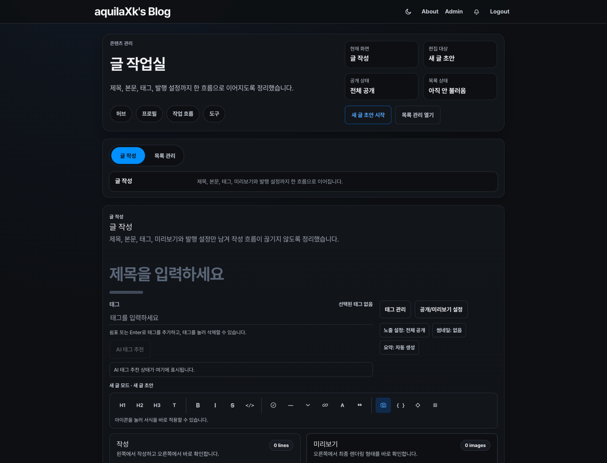

# Aquila Office

<!-- PROJECT LOGO -->
<p align="center">
  <a href="https://github.com/AquilaXk/aquila-office">
    
  </a>
</p>

<h3 align="center">Aquila Office</h3>

<p align="center">
  AI-assisted workspace operations for agents, tasks, artifacts, chat, and integrations.
  <br />
  <a href="COMPLETION_CHECKLIST.md"><strong>Release evidence »</strong></a>
  <br />
  <br />
  <a href="README.md#getting-started">Getting Started</a>
  ·
  <a href="README.md#development">Development</a>
  ·
  <a href="README.md#integrations">Integrations</a>
  ·
  <a href="README.md#troubleshooting">Troubleshooting</a>
</p>

<p align="center">
  
  
  
  
  
  
</p>

<!-- ABOUT THE PROJECT -->

## About the Project



# AI-assisted workspace operations for teams

Aquila Office combines a Java 21 + Spring Boot backend with a Next.js frontend to coordinate workspace members, AI agents, tasks, generated artifacts, chat, presence, and external integrations.

The application is designed around workspaces. Each workspace owns its members, agents, task executions, reports, chat sessions, Gateway binding, Slack mappings, GitHub credentials, and generated artifacts. The backend exposes a versioned API and the frontend provides a dense operational interface for repeated project work.

Completion criteria are tracked in [COMPLETION_CHECKLIST.md](COMPLETION_CHECKLIST.md).

### API map

All backend responses use the shared `RsData` envelope unless the endpoint is an actuator or static infrastructure endpoint.

| Area | Method and path | Purpose |
| --- | --- | --- |
| Health | `GET /api/health` | Lightweight service health envelope |
| Metrics | `GET /actuator/prometheus` | Prometheus scrape endpoint |
| Auth | `POST /api/v1/auth/google/login` | Verify Google ID token and issue access/refresh tokens |
| Auth | `POST /api/v1/auth/token/refresh` | Rotate refresh token and issue a new token pair |
| Auth | `POST /api/v1/auth/logout` | Revoke refresh token |
| Workspaces | `GET /api/v1/workspaces` | List joined workspaces |
| Workspaces | `POST /api/v1/workspaces` | Create workspace |
| Workspaces | `GET /api/v1/workspaces/{workspaceId}` | Read workspace detail |
| Workspaces | `GET /api/v1/workspaces/{workspaceId}/dashboard/summary` | Read dashboard counts, logs, and reports |
| Members | `GET /api/v1/workspaces/{workspaceId}/members` | List workspace members |
| Members | `GET /api/v1/workspaces/{workspaceId}/members/task-stats` | Read member task score summary |
| Agents | `GET /api/v1/workspaces/{workspaceId}/agents` | List workspace agents |
| Agents | `POST /api/v1/workspaces/{workspaceId}/agents` | Create workspace agent and sync skill files |
| Agents | `DELETE /api/v1/workspaces/{workspaceId}/agents/{agentId}` | Delete workspace agent |
| Tasks | `GET /api/v1/workspaces/{workspaceId}/tasks` | List workspace tasks |
| Tasks | `POST /api/v1/workspaces/{workspaceId}/tasks/run` | Create and run a task |
| Tasks | `POST /api/v1/workspaces/{workspaceId}/tasks/{taskId}/run` | Run an existing task |
| Reports | `GET /api/v1/workspaces/{workspaceId}/tasks/{taskId}/reports` | List task execution reports |
| Chat | `POST /api/v1/workspaces/{workspaceId}/chat/messages` | Send workspace or task chat message |
| Artifacts | `GET /api/v1/workspaces/{workspaceId}/artifacts/tree` | Read artifact tree |
| Artifacts | `GET /api/v1/workspaces/{workspaceId}/artifacts/files?path=...` | Read artifact file content |
| Integrations | `GET /api/v1/workspaces/{workspaceId}/github/credentials` | List GitHub credentials |
| Integrations | `GET /api/v1/workspaces/{workspaceId}/slack/integrations` | List Slack integrations |
| Integrations | `GET /api/v1/workspaces/{workspaceId}/gateway` | Read Gateway binding status |
| Presence | `GET /api/v1/workspaces/{workspaceId}/presence/stream` | Open workspace presence SSE stream |
| Presence | `PATCH /api/v1/workspaces/{workspaceId}/presence/me/position` | Update member position |

### Domain model

The backend keeps domain logic in Java objects and persists current state through JPA adapters.

| Entity | Key relationships |
| --- | --- |
| `Member` | Owns Google identity and role. Has one `MemberProfile`. |
| `Workspace` | Created by a Google subject. Has many `WorkspaceMember`, `WorkspaceAgent`, `Task`, invites, integrations, and artifacts. |
| `WorkspaceMember` | Joins a `Member` to a `Workspace` with a workspace role. |
| `WorkspaceInvite` | Stores invited email, token, expiry, accepted, and revoked timestamps for workspace onboarding. |
| `WorkspaceAgent` | Belongs to a `Workspace`; can have many `WorkspaceAgentSkillFile` entries and a Gateway agent ID. |
| `Task` | Belongs to a `Workspace`; can be assigned to an agent and progresses through requested, running, completed, failed, or canceled states. |
| `TaskExecution` | Stores a task run lifecycle, final text, failure reason, and report data. |
| `TaskExecutionLog` | Stores log lines for a `TaskExecution`. |
| `ChatSession` | Groups chat messages for workspace and task interaction. |
| `ChatMessage` | Stores role, content, and task linkage for chat responses. |
| `WorkspaceGatewayBinding` | Stores Gateway mode, URL, encrypted token, and connection status. |
| `SlackChannelMapping` | Maps a Slack team/channel to a workspace with encrypted bot token material. |
| `GithubCredential` | Stores encrypted GitHub token material for repository work. |
| `OrchestrationSession` | Tracks multi-agent plan execution and has many `OrchestrationStep` rows. |

## Recognition

Current release evidence is recorded in [COMPLETION_CHECKLIST.md](COMPLETION_CHECKLIST.md). Before release, the issue list should be empty after the release-evidence PR is merged, the latest `main` CI workflow run should show only passing jobs, and the checklist should have no unresolved release blocker or unchecked final-state item.

### Built With

- [Java 21](https://openjdk.org/projects/jdk/21/)
- [Spring Boot](https://spring.io/projects/spring-boot)
- [Gradle](https://gradle.org/)
- [Next.js](https://nextjs.org/)
- [React](https://react.dev/)
- [PostgreSQL](https://www.postgresql.org/)
- [Docker Compose](https://docs.docker.com/compose/)
- [k6](https://k6.io/)
- [Google Vertex AI](https://cloud.google.com/vertex-ai)

## Contact us

Use GitHub issues and pull requests in this repository for product, implementation, and release work. Keep secrets and environment-specific credentials out of public issue and PR text.

## Stay Up-to-Date

Watch repository releases and workflow runs for updates. Release readiness is tracked through:

```bash
gh issue list --repo AquilaXk/aquila-office --state open --limit 50
gh run list --repo AquilaXk/aquila-office --branch main --limit 10
```

<!-- GETTING STARTED -->

## Getting Started

To get a local copy up and running, follow these steps.

### Prerequisites

You need:

- Java 21
- Node.js 20 or later
- Docker Desktop or a compatible Docker engine
- PostgreSQL 17 when running without Compose
- k6 for local smoke checks

> Optional integrations require their own credentials. See [Integrations](#integrations) for Google OAuth, Vertex AI, Gateway, Slack, and GitHub setup notes.

## Development

### Setup

1. Clone the repository.

   ```bash
   git clone https://github.com/AquilaXk/aquila-office.git
   cd aquila-office
   ```

2. Create a local environment file from the tracked sample.

   ```bash
   cp .env.example .env
   ```

3. Keep private values local. `vertex-key.json` is intentionally ignored and can be mounted by Docker Compose through `VERTEX_AI_CREDENTIALS_HOST_PATH`.

4. Install frontend dependencies when running the frontend directly.

   ```bash
   npm --prefix front install
   ```

#### Quick start with Docker Compose

The fastest local path starts PostgreSQL, backend, frontend, and the nginx entrypoint:

```bash
docker compose --env-file .env.example -f compose.dev.yml up --build
```

Default local endpoints:

- Backend API: `http://localhost:8080`
- Frontend app: `http://localhost:3000`
- Health: `GET /api/health`
- Actuator liveness: `GET /actuator/health/liveness`
- Actuator readiness: `GET /actuator/health/readiness`
- Prometheus metrics: `GET /actuator/prometheus`

#### Development tip

Run backend and frontend directly when iterating on one side of the stack:

```bash
./back/gradlew -p back check
./back/gradlew -p back bootRun
```

```bash
npm --prefix front run test:node
npm --prefix front run lint
npm --prefix front run build
npx --prefix front playwright install chromium
npm --prefix front run test:browser
npm --prefix front run dev
```

#### Manual setup

Configure `.env` before running services without Compose.

| Name | Default | Purpose |
| --- | --- | --- |
| `POSTGRES_DB` | `aquila_office` | Local PostgreSQL database name |
| `POSTGRES_USER` | `aquila` | Local PostgreSQL user |
| `POSTGRES_PASSWORD` | `aquila_dev_password` | Local PostgreSQL password |
| `BACKEND_PORT` | `8080` | Host port for the backend container |
| `FRONTEND_PORT` | `3000` | Host port for the frontend container |
| `NEXT_PUBLIC_API_BASE_URL` | `http://localhost:8080` | Frontend API base URL |
| `CUSTOM_CORS_ALLOWED_ORIGIN_PATTERNS` | `http://localhost:3000,http://localhost` | Browser origins allowed by the backend |
| `AQUILA_AUTH_TOKEN_ISSUER` | `aquila-office` | JWT issuer |
| `AQUILA_AUTH_TOKEN_SECRET` | local development secret | JWT signing secret; replace outside local runs |
| `AQUILA_AUTH_ACCESS_TOKEN_TTL` | `15m` | Access token lifetime |
| `AQUILA_AUTH_REFRESH_TOKEN_TTL` | `14d` | Refresh token lifetime |
| `AQUILA_EXTERNAL_TOKEN_KEY` | local development key | AES-GCM key for external tokens; replace outside local runs |
| `AQUILA_EXTERNAL_TOKEN_KEY_ID` | `local` | External token key identifier |
| `AQUILA_GOOGLE_OAUTH_CLIENT_IDS` | development client ID | Accepted Google OAuth client IDs |
| `AQUILA_GOOGLE_ALLOWED_HOSTED_DOMAINS` | empty | Optional Google hosted-domain allow list |
| `AQUILA_GOOGLE_REQUIRE_EMAIL_VERIFIED` | `true` | Require verified Google email claims |
| `GOOGLE_CLOUD_PROJECT_ID` | `grepp-ai-project` | Vertex AI project ID |
| `VERTEX_AI_LOCATION` | `us-central1` | Vertex AI region |
| `VERTEX_AI_MODEL` | `gemini-2.5-flash` | Vertex AI model |
| `GOOGLE_APPLICATION_CREDENTIALS` | `/run/secrets/vertex-key.json` | Runtime credential file path |
| `VERTEX_AI_CREDENTIALS_HOST_PATH` | `./vertex-key.json` | Local service account key path mounted into Compose |
| `AQUILA_SLACK_CLIENT_ID` | empty | Slack OAuth client ID |
| `AQUILA_SLACK_CLIENT_SECRET` | empty | Slack OAuth client secret |
| `AQUILA_SLACK_SIGNING_SECRET` | empty | Slack event signature secret |
| `AQUILA_INVITE_EMAIL_ENABLED` | `false` | Enable SMTP invite delivery |

#### Setting up your first user

Google OAuth is the normal entry point. Configure `AQUILA_GOOGLE_OAUTH_CLIENT_IDS` and `NEXT_PUBLIC_GOOGLE_CLIENT_ID`, then sign in through the frontend. For deterministic local service-journey checks, run the backend with `SPRING_PROFILES_ACTIVE=smoke` and `AQUILA_SMOKE_FIXTURE_ENABLED=true`.

### E2E-Testing

Run browser regression tests from the repository root:

```bash
npx --prefix front playwright install chromium
npm --prefix front run test:browser
```

#### Resolving issues

- If browsers are missing, rerun `npx --prefix front playwright install chromium`.
- If the frontend cannot reach the backend, confirm `NEXT_PUBLIC_API_BASE_URL` and backend CORS settings.
- If local ports are busy, update `BACKEND_PORT`, `FRONTEND_PORT`, or `POSTGRES_PORT` in `.env`.

### Upgrading from earlier versions

Re-run the full local gates after dependency or schema changes:

```bash
./back/gradlew -p back check
npm --prefix front run test:node
npm --prefix front run lint
npm --prefix front run build
npm --prefix front run test:browser
node tools/readme/validate-readme.mjs
```

## Deployment

### Docker

Build and run the local stack with:

```bash
docker compose --env-file .env.example -f compose.dev.yml up --build
```

Replace local defaults for `AQUILA_AUTH_TOKEN_SECRET`, `AQUILA_EXTERNAL_TOKEN_KEY`, database passwords, Slack secrets, and Google credentials before shared environments.

### OCI blue-green

Deployment scripts:

- `scripts/deploy/backend-blue-green.sh` builds a backend image and switches traffic after health confirmation.
- `scripts/deploy/oci-backend-hook.sh` is the OCI host hook entrypoint.
- `scripts/deploy/validate-backend-cd.sh` performs syntax and required-file checks for deployment scripts.

## Roadmap

Use issues for roadmap-sized work. Current release evidence and remaining completion criteria live in [COMPLETION_CHECKLIST.md](COMPLETION_CHECKLIST.md).

## License

No repository license file is currently published. Add a `LICENSE` file before distributing or accepting outside contributions under a formal license.

## Repo Activity

Use GitHub issue, PR, and Actions views for repository activity:

```bash
gh issue list --repo AquilaXk/aquila-office --state open --limit 50
gh run list --repo AquilaXk/aquila-office --branch main --limit 10
```

## Contributing

1. Create or select the issue for the work item.
2. Create a focused branch from `main`.
3. Implement with focused commits and local verification.
4. Open a pull request that links the issue.
5. Merge after checks pass and confirm the main branch CI run.

Local agent files such as `AGENTS.md`, `docs/`, and `.codex/` are intentionally ignored and are not part of runtime documentation.

### Good First Issues

Good first issues are small documentation, frontend copy, test, or validation improvements with a clear verification command. Avoid broad infrastructure or secret-handling changes for first contributions.

### Contributors

Contributors should keep PRs focused, avoid unrelated formatting churn, and include the exact commands used to verify the change.

## Enabling Content Security Policy

Define Content Security Policy at the reverse proxy, platform, or frontend middleware layer before exposing shared environments. Make sure Google OAuth, frontend assets, backend API calls, and any allowed integration origins are represented explicitly.

## Single Workspace Mode

Aquila Office currently models multiple workspaces. Single-workspace deployments should enforce workspace creation, membership, and routing policy at the application or deployment layer rather than relying on hidden frontend state.

## Integrations

### Google OAuth

Configure:

- `AQUILA_GOOGLE_OAUTH_CLIENT_IDS`
- `AQUILA_GOOGLE_ALLOWED_HOSTED_DOMAINS`
- `AQUILA_GOOGLE_REQUIRE_EMAIL_VERIFIED`
- `NEXT_PUBLIC_GOOGLE_CLIENT_ID`

### Vertex AI

Configure:

- `GOOGLE_CLOUD_PROJECT_ID`
- `VERTEX_AI_LOCATION`
- `VERTEX_AI_MODEL`
- `GOOGLE_APPLICATION_CREDENTIALS`
- `VERTEX_AI_CREDENTIALS_HOST_PATH`

Keep `vertex-key.json` outside git. Use `VERTEX_AI_CREDENTIALS_HOST_PATH` if the credential file is not at the repository root.

### Gateway

Gateway configuration uses encrypted token material and workspace-level binding state. Confirm Gateway URL, `/rpc` path, encrypted token, and `/api/v1/workspaces/{workspaceId}/gateway` when agent runs fail.

### Slack

Configure:

- `AQUILA_SLACK_CLIENT_ID`
- `AQUILA_SLACK_CLIENT_SECRET`
- `AQUILA_SLACK_SIGNING_SECRET`

Slack event metrics include signature failures, duplicate skips, and processing failures.

### GitHub

GitHub work requires a `GithubCredential` for the workspace and a token with repository permissions. Keep token material out of logs, issues, PR text, and metric labels.

## Workflows

### Local smoke checks

Run a local smoke test after the backend is listening on `8080`:

```bash
tools/test/run-k6-smoke.sh
```

The service journey smoke requires `SPRING_PROFILES_ACTIVE=smoke` and `AQUILA_SMOKE_FIXTURE_ENABLED=true` so Google login and Gateway execution use deterministic fixture adapters.

The k6 smoke covers:

- `GET /api/health`
- `GET /actuator/health/liveness`
- `GET /actuator/health/readiness`
- `GET /actuator/prometheus`
- `POST /api/v1/auth/google/login`
- `POST /api/v1/workspaces`
- `POST /api/v1/workspaces/{workspaceId}/gateway/binding`
- `POST /api/v1/workspaces/{workspaceId}/agents`
- `POST /api/v1/workspaces/{workspaceId}/tasks`
- `POST /api/v1/workspaces/{workspaceId}/tasks/{taskId}/run`
- `GET /api/v1/workspaces/{workspaceId}/tasks/{taskId}/reports`

### Release preflight

Run:

```bash
node tools/readme/validate-readme.mjs
node tools/perf/validate-k6-smoke.mjs
gh issue list --repo AquilaXk/aquila-office --state open --limit 50
gh run list --repo AquilaXk/aquila-office --branch main --limit 10
```

Prometheus scrape settings:

- Scrape path: `/actuator/prometheus`
- Default target: `backend:8080` in Docker networks, or `localhost:8080` for local runs
- Recommended alert inputs: `http_server_requests_seconds`, `http_req_failed`, JVM memory, HikariCP connection gauges, and process CPU usage

Workflow metrics:

| Metric | Labels | Purpose |
| --- | --- | --- |
| `aquila_task_execution_started_total` | none | Task execution start count |
| `aquila_task_execution_completed_total` | `status=succeeded\|failed` | Task execution outcome count |
| `aquila_task_execution_duration_seconds` | `status=succeeded\|failed` | Task execution latency |
| `aquila_gateway_rpc_requests_total` | `method` | Gateway RPC request count |
| `aquila_gateway_rpc_completed_total` | `method`, `outcome=success\|failure\|timeout` | Gateway RPC result count |
| `aquila_gateway_rpc_latency_seconds` | `method`, `outcome=success\|failure\|timeout` | Gateway RPC latency |
| `aquila_slack_events_received_total` | `route=global\|workspace` | Slack event receive count |
| `aquila_slack_events_signature_failures_total` | `route=global\|workspace` | Slack signature verification failures |
| `aquila_slack_events_dedupe_hits_total` | none | Slack duplicate event skips |
| `aquila_slack_events_processing_failures_total` | `stage=payload_parse\|signature_config\|use_case` | Slack processing failures |

Metric labels are fixed low-cardinality values. Workspace IDs, user IDs, URLs, tokens, prompts, and failure text are never used as labels.

Alert examples:

- Task failure ratio: `sum(rate(aquila_task_execution_completed_total{status="failed"}[5m])) / sum(rate(aquila_task_execution_completed_total[5m])) > 0.2`
- Gateway timeout spike: `sum(rate(aquila_gateway_rpc_completed_total{outcome="timeout"}[5m])) > 0`
- Slack signature failures: `sum(rate(aquila_slack_events_signature_failures_total[5m])) > 0`

## Acknowledgements

Aquila Office depends on the Java, Spring, Next.js, React, PostgreSQL, Docker, k6, Google Cloud, Slack, and GitHub ecosystems.

## Troubleshooting

| Symptom | Check |
| --- | --- |
| Backend does not start | Confirm Java 21, port `8080`, and database availability. Run `./back/gradlew -p back bootRun` from the repository root. |
| Frontend cannot reach API | Confirm `NEXT_PUBLIC_API_BASE_URL`, backend CORS patterns, and browser network logs. |
| Google login fails | Confirm `AQUILA_GOOGLE_OAUTH_CLIENT_IDS`, hosted-domain settings, and that the ID token audience matches the configured client. |
| Vertex AI calls fail | Confirm `GOOGLE_CLOUD_PROJECT_ID`, `VERTEX_AI_LOCATION`, `VERTEX_AI_MODEL`, and `GOOGLE_APPLICATION_CREDENTIALS`. Do not commit the credential file. |
| Gateway agent runs fail | Confirm Gateway URL, `/rpc` path, encrypted token, and `/api/v1/workspaces/{workspaceId}/gateway`. |
| Slack events fail | Confirm signing secret, OAuth callback URL, channel mapping, and event deduplication state. |
| GitHub work fails | Confirm `GithubCredential` exists for the workspace and the token has repository permissions. |
| k6 smoke fails on health | Check `/actuator/health/liveness`, `/actuator/health/readiness`, and `/actuator/prometheus` individually with `curl -i`. |
